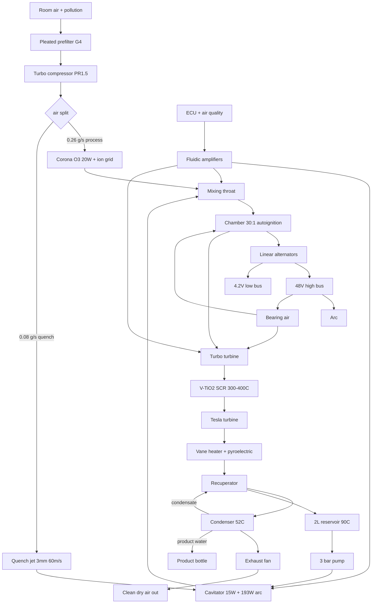

# PROJECT COOL POWER CORE
## Automated Closed-Loop Atmospheric Remediation Engine
## & Multi-Frontier Micro-Purification Architecture
### Build & Maintenance Manual — Rev 2.0
### Designer: Thomas G Coleman

**Status:** build-issue. Rev 2.0 reframes the project as a purifier/dehumidifier with electrical surplus. Supersedes 1.3.

**Read §18 first.**

---

## 1. Function

Destroys airborne pollution by plasma-thermal oxidation, condenses water out of the airstream, and returns a net electrical surplus.

**Duty:** point-of-breathing, vehicle cabin, sealed compartment. Not a room purifier.

| Job | Mechanism | Rated |
|---|---|---|
| VOC destruction | 3000 °C arc + 900 °C chamber | 90–99% |
| CO oxidation | same | 60–80% |
| O₃ destruction | thermal, >250 °C | >99% |
| PM2.5 / soot | thermal oxidation + prefilter | >99% |
| NOx reduction | V₂O₅/TiO₂ SCR, 300–400 °C | 70–90% |
| Dehumidification | condenser at 52 °C | 156 g/h @60% RH |
| Clean water product | condensate | +120 g/h |
| Electric surplus | alternators | 225–450 W |

**The fuel is water, not pollution.** Pollution contributes ~1 W of 350 W. It is the product stream.

---

## 2. Specification

| Parameter | Value | Tolerance |
|---|---|---|
| Configuration | Opposed free piston, dual linear alternator | — |
| Bore × stroke | 25 mm × 40 mm | ±0.005 |
| Compression ratio | 30:1 (V_c 1.354 cm³) | ±0.05 cm³ |
| Cycle rate | 5 / 25 / 50 Hz, three modes | ±0.5 |
| Mean piston speed | 0.4 / 2.0 / 4.0 m/s | — |
| Air throughput | 1.1 / 5.4 / 10.8 m³/h | ±5% |
| Chamber dwell | 6.9 / 1.4 / 0.69 ms | — |
| Liner | YSZ 0.4 mm on Inconel 625 | — |
| Guidance | Aerostatic, 5 µm, 6 bar | 4–7 µm |
| Turbo | 25 mm Ti / 22 mm Inconel, PR 1.5, 200 000 rpm | max 240 000 |
| Water feed | 0.15 g/s | ±0.01 |
| Reservoir | 2 L @ 90 °C | ±2 K |
| Cavitator | 15 W, 3 bar, σ = 0.2 | ±0.03 |
| Arc | 193 W, 33.6 kV | ±10 W |
| Corona / O₃ | 20 W, 100 ppm — **ignition-critical** | 80–120 |
| Quench | Cold compressor air, 0.08 g/s, 3.0 mm, 60 m/s | — |
| SCR | V₂O₅/TiO₂ 400 cpsi, 300–400 °C | — |
| Condensing | 52 °C | ±2 K |
| Buses | 48 V high / 4.2 V low | — |
| Electric surplus | 225–450 W (Mode 3) | — |
| Net water | +120 g/h @ ≥58% RH | — |
| Life | 25 000 h | MTBO 2 000–4 000 |

---

## 3. Chemistry

**Ignition.** 30:1 on a 40%-steam charge gives $T_2 = 861$ K against an 858 K autoignition point. Three kelvin. The corona supplies O₃ and O-radicals to trip ignition reliably inside the dwell window. **Corona is an ignition system here, not an ozone generator.**

**Ozone.** 100 ppm into the arc zone. Thermal decomposition above 250 °C yields O-radical and O₂. All O₃ is gone by the exhaust; none escapes.

**Cracking.** Water → H• + OH• in the cavitation and arc zone, partial recombination to H₂. 15–30% dissociation, quenched at >10⁸ K/s by cold compressor air.

**NOx.** Zeldovich, fast above 1800 °C. 100–300 ppm generated at the arc, 10–30 ppm after SCR. **Net NOx source.** Steam injection suppresses peak temperature and is the main NOx control before the catalyst.

**SOx.** Urban SO₂ 5–30 ppb oxidises to SO₃, forms H₂SO₄, condenses in the recuperator. Acid condensate, pH 3–4. Reservoir must be HDPE. Descaling is mandatory, not optional.

---

## 4. Water balance

| RH @ 25 °C | Water in air | Engine need | Result |
|---|---|---|---|
| 30% | 78 g/h | 150 g/h | −72 g/h, needs top-up |
| 45% | 117 g/h | 150 g/h | −33 g/h |
| **58%** | **150 g/h** | **150 g/h** | **break-even** |
| 75% | 195 g/h | 150 g/h | +45 g/h |
| 90% | 234 g/h | 150 g/h | +84 g/h |

Plus 162 g/h of combustion water, 85% recovered = +138 g/h at every RH.

**Self-sufficient above 58% RH. Below that, top up 2 L reservoir every 28 h at 30% RH.** The dehumidifier function and the fuel supply are the same stream — that is the elegant part of the architecture and also its limit.

Dehumidification rate at 60% RH, 156 g/h, drops a 50 m³ room 21% RH per hour.

---

## 5. Architecture

**Flow order is fixed.** Prefilter → compressor → corona → mix → chamber → turbine → SCR → Tesla → vanes → recuperator → condenser → fan → out. Corona before mixing throat, always.

---

## 6. Modes

| | M1 Personal | M2 Cabin | M3 Room |
|---|---|---|---|
| Frequency | 5 Hz | 25 Hz | 50 Hz |
| Throughput | 1.1 m³/h | 5.4 m³/h | 10.8 m³/h |
| Dwell | 6.9 ms | 1.4 ms | 0.69 ms |
| Electric | ~35 W draw | ~110 W draw | 225–450 W surplus |
| Application | wearable, breathing-rate | vehicle cabin, compartment | stationary, small room |
| Destruction | best (10× dwell) | good | adequate |

**M1 is the best purifier and the worst generator.** Dwell is ten times longer and the arc has more time per unit mass. If the goal is clean air, run M1. If the goal is power, run M3 and accept 0.69 ms.

---

## 7. Bill of materials

| # | Item | Spec | Qty |
|---|---|---|---|
| 7.1 | Prefilter | G4 pleated, 0.4 m² | 1 |
| 7.2 | Cylinder barrel | Inconel 625, YSZ 0.4 mm | 1 |
| 7.3 | Piston body | Inconel 625, graphite-bronze lands | 2 |
| 7.4 | Crown insert | YSZ-faced, replaceable | 2 |
| 7.5 | Magnet stack | N52H radial | 2 |
| 7.6 | Alternator stator | Cu class H, 48 V | 2 |
| 7.7 | Position sensors | Eddy + Hall, 0.01 mm | 4 |
| 7.8 | Turbo rotor | Ti-6Al-4V / Inconel 713C | 1 |
| 7.9 | Turbo bearing cartridge | Aerostatic 6 mm | 1 |
| 7.10 | Turbo gen stator | 80 W, 200 000 rpm | 1 |
| 7.11 | Cavitator body | 17-4PH, graphene coated | 1 |
| 7.12 | Arc electrode | W-ThO₂ 2 mm | 2 |
| 7.13 | Corona assembly | 33.6 kV needle-plane, 4 mm | 1 |
| 7.14 | SCR block | V₂O₅/TiO₂ 400 cpsi | 1 |
| 7.15 | Tesla stack | 17-4PH 0.3 mm discs | 1 |
| 7.16 | Vane heater | 16 vanes, hard PZT 15 µm | 1 |
| 7.17 | Recuperator | Brazed 316L, acid-rated | 1 |
| 7.18 | Condenser | 1.1 m² Al, epoxy coated | 1 |
| 7.19 | Exhaust fan | 40 mm, 10 W | 1 |
| 7.20 | Reservoir | 2 L HDPE, 20 mm lagging | 1 |
| 7.21 | Water pump | Diaphragm 3 bar 0.5 mL/min | 1 |
| 7.22 | Bearing air compressor | Scroll 6 bar 95 W | 1 |
| 7.23 | Accumulator | 0.5 L 6 bar 30 s | 1 |
| 7.24 | Fluidic amplifiers | Vortex ×2 fail-closed, Coanda ×2 fail-open | 4 |
| 7.25 | Piezo pilots | 48 V 2 kHz | 4 |
| 7.26 | ECU | Dual-bus, conformal | 1 |
| 7.27 | PTC cold-start | 500 W, 90 °C stat | 1 |
| 7.28 | Product bottle | 2 L HDPE, float valve | 1 |

**Acid service:** every condensate-wet part 316L or HDPE. No aluminium downstream of the recuperator except the epoxy-coated condenser.

---

## 8. Build

### 8.1 Barrel
YSZ 0.4 mm, hone 25.000 +0.005, air-gauge 3 stations. Feed ring 12 × 0.3 mm, ultrasonic clean. Flow-check 1.5 NL/min ±15% per bearing. Jacket leak 2 bar / 10 min / zero drop.

### 8.2 Pistons
Crown insert 0.02 mm proud, no rocking. Magnets on 200 °C epoxy, cure 2 h / 150 °C, gauss 1.2–1.35 T. Balance 0.05 g·mm. Sensor targets 0.01 mm repeatability over 50 strokes.

### 8.3 Alternators
42 turns class H, vacuum varnish, bake. 500 V DC >100 MΩ. Gap 0.6 mm at 4 points.

### 8.4 Turbo
Balance 0.2 mg·mm at 200 000 rpm. Axial 0.08 mm, tip 0.15 mm. Air spin to 240 000, coast-down >25 s. **Prove the accumulator by cutting supply.**

### 8.5 Cavitator, corona, arc
Orifice 0.8 mm, σ 0.2 at 3 bar / 90 °C. Corona gap 4 mm, 10/10 at 33.6 kV. Arc gap 1.5 mm. **Corona must strike before arc enable in firmware, not by procedure.**

### 8.6 Exhaust train
Recuperator braze, 2 bar both sides. SCR on 5 mm ceramic gasket, no bypass. Tesla 0.25 mm gaps, free by hand. **Confirm no aluminium in the acid path.**

### 8.7 Fluidics
Vortex on recirculation and quench, **verify fail-closed with supply off.** Coanda on mix, fail-open. Supply 2 bar, 5 µm, desiccant dried.

### 8.8 Final
TDC 2.76 mm ±0.05 by shim, bore-scope. 6 bar decay <0.1 bar/min. Fill, PTC 90 °C, 30 min, log.

---

## 9. Instrumentation

| Tag | Device | Range | Purpose |
|---|---|---|---|
| PS-1/2 | Eddy-current | ±2 mm | Position |
| PS-3/4 | Hall | — | Redundancy |
| PT-1 | Piezo | 0–150 bar | Chamber |
| PT-2 | Piezo | 0–3 bar | Boost |
| TT-1/2/3 | K-type | 0–1200 °C | Turbine, SCR |
| TT-4/5 | PT100 | 0–120 °C | Reservoir, condensate |
| RH-1 | Heated capacitive | 0–100% | Inlet RH |
| RH-2 | Heated capacitive | 0–100% | Outlet RH |
| FT-1 | Coriolis | 0–1 g/s | Water |
| FT-2 | Hot-film | 0–1 g/s | Air |
| UV-1 | UV absorption | 0–500 ppm | O₃ |
| VS-1 | Optical | 0–300 000 rpm | Turbo |
| AN-1 | Condenser mic | — | Cavitation |
| **PM-1** | **Optical PM2.5** | **0–1000 µg/m³** | **Inlet** |
| **PM-2** | **Optical PM2.5** | **0–1000 µg/m³** | **Outlet** |
| **VOC-1/2** | **PID 10.6 eV** | **0–100 ppm** | **In/out** |
| **CO-1/2** | **NDIR** | **0–500 ppm** | **In/out** |
| **NOx-1/2** | **Electrochemical** | **0–1000 ppb** | **In/out** |
| **SO₂-1/2** | **Electrochemical** | **0–500 ppb** | **In/out** |

Paired in/out sensors are how you prove the machine works. **Report single-pass destruction efficiency, not inlet concentration.** AN-1 remains the cracking readout; the paired sensors are the product readout.

---

## 10. ECU

**States:** OFF → PRIME → WARMUP → RUN → TRIM → COOLDOWN → FAULT.

| Loop | Rate | Action |
|---|---|---|
| TDC | per cycle | Alternator current, hard stop 2.60 mm |
| **Corona before arc** | per cycle | Arc enable gated on corona strike |
| Injection | 1 kHz | Coanda duty, FT-1 |
| Humidity | 100 Hz | Vortex, 92 ± 3% |
| Quench | 500 Hz | Vortex, PT-2 |
| Arc | 5 kHz | Current source, 193 W |
| Boost | 100 Hz | Turbine bypass |
| Preheat | 10 Hz | Diverter + PTC |
| Mode | 1 Hz | Air quality demand → Hz setpoint |

**Interlocks, all latching:**

| Condition | Trip |
|---|---|
| Turbo overspeed | >240 000 rpm |
| Bearing air loss | <4 bar, 200 ms |
| **Corona loss** | **arc inhibited, 100 ms** |
| TDC overshoot | <2.60 mm |
| Water loss | <0.10 g/s, 5 s |
| Reservoir overtemp | >96 °C |
| Arc fault | 3 strikes |
| SCR overtemp | >450 °C |
| **SCR cold** | **>280 °C before M2/M3** |
| Condenser overtemp | >60 °C |
| AN-1 shift | >6 dB |

**Sequencing:** turbo 60 000 rpm → corona strike confirmed → arc → stable 5 s → injection → chamber 600 °C → quench. On FAULT: arc → injection → quench → turbo idle → 5 min → OFF. **Never cut bearing air before coast-down.**

Mode selection is demand-driven from PM-2 and VOC-2, not user-selected.

---

## 11. Commissioning

1. Dry crank 50 strokes, 5 µm film, no contact.
2. Turbo air spin 100 000 → 240 000, coast-down >25 s.
3. Cold water, no arc, σ and AN-1 baseline.
4. Corona only, 30 min, verify 100 ppm and strike reliability.
5. **Arc without corona — confirm misfire, then with corona — confirm fire.** Prove the dependency.
6. First fire 5 Hz, injection 50%, then nominal.
7. **Air quality test:** challenge with a calibrated VOC source (isobutylene 1 ppm) and incense PM. Measure single-pass DE at all three modes. **Reject any mode below 90% VOC DE.**
8. Water balance at 30/58/75% RH. Confirm the 58% break-even.
9. Baseline every sensor and the AN-1 spectrum.

---

## 12. Limits

| Parameter | Min | Nom | Max |
|---|---|---|---|
| Frequency | 5 Hz | 25 Hz | 50 Hz |
| Reservoir | 80 °C | 90 °C | 96 °C |
| Boost | 1.0 | 1.5 | 1.7 |
| Turbine inlet | 600 °C | 900 °C | 980 °C |
| SCR | 280 °C | 350 °C | 440 °C |
| Condensing | 45 °C | 52 °C | 60 °C |
| Inlet RH | 15% | 50% | 99% |
| Ambient | −5 °C | 20 °C | 45 °C |

Below 15% RH the machine is water-negative and needs a reservoir top-up every 20 h. Below 80 °C reservoir, radical yield collapses.

---

## 13. Maintenance

| Interval | Action |
|---|---|
| 25 h | Log all sensors, paired air quality, AN-1 vs baseline |
| 100 h | Prefilter, accumulator precharge, product bottle |
| 250 h | **Acid descale recuperator and condenser**, coalescing filter |
| 500 h | Prefilter replace, electrode dress, fluidic dewpoint, **pH test condensate** |
| 1000 h | Orifice inspect, bore-scope, insulation test, recoat graphene, **SCR activity check** |
| 2000 h | Crown inserts, reservoir descale, strip fluidics, turbo tip clearance |
| 4000 h | Orifice replace, vane module, recuperator flow test |
| 8000 h | Full teardown, SCR replace, turbo rotor, all seals, re-baseline |

**Acid service at 250 h is the one people skip.** Sulphuric condensate will eat a recuperator in 1500 h if you let it.

---

## 14. Failure modes

| Mode | Cause | Symptom | Remedy |
|---|---|---|---|
| Misfire | Corona dead, water high | Rough running, HC breakthrough | Corona check, **arc inhibited** |
| Piston contact | Film collapse, growth | Scoring, knock | Bearing air, thermal break, barrel if >0.02 mm |
| Turbo crash | Air loss, overspeed | Stop, VS-1 loss | Rotor + cartridge, new accumulator |
| Arc quench-out | Early quench, flood | Strike fail | Sequence, dry gap, electrodes |
| Cavitator clog | Scale, particulate | σ rise, AN-1 drop | Acid descale, orifice |
| Catalyst cold | Low load, vane heater ahead of SCR | NOx breakthrough, VOC slip | Reorder, hold >30% load |
| Catalyst poisoned | Sulphur, soot | Falling DE at normal temp | SCR replace |
| Recuperator perforation | Acid | Water in exhaust, DE loss | Replace |
| Water negative | Low RH, leak | Reservoir falls | Top up, cap O₂ export |
| Condenser fouling | Scale, biofilm | Condensing temp rise | Descale, biocide |
| Fluidic clog | Wet air | Injection drift | Desiccant, strip, clean |

---

## 15. Spares

Two of each: crown inserts, electrodes, orifices, turbo rotor + cartridge, accumulator, all filters, fluidic amps, piezo pilots, position sensors, pump kits, desiccant, graphene, gaskets, **pH strips**. One each: stator, SCR block, recuperator, ECU.

---

## 16. Siting

Sealed or semi-sealed space only. In open air, 10.8 m³/h is lost in the background and the machine looks useless.

- 10 m³ sealed cabin → 1 ACH, M2
- Vehicle cabin on recirculate → M2
- Breathing zone, headrest or backpack → M1
- Room → M3 plus a second unit

**Never recirculate into a space with a gas appliance.** The machine is an NOx source.

---

## 17. Outputs

| Stream | Rate | Notes |
|---|---|---|
| Clean dry air | 10.8 m³/h | 95%+ PM/VOC/O₃ destruction |
| Product water | 120 g/h @60% RH | pH 3–4, distilled-grade, **drinkable after carbon polish** |
| O₂ | 140 g/h | 92–95% purity, cap 150 |
| Electric | 225–450 W | 48 V DC |
| Heat | ~450 W | room heat, useful in winter, a problem in summer |

Condensate is distilled but acidic. Drinkable through a 5 µm carbon block; not drinkable straight.

---

## 18. Honest limits

**The pollution is not the fuel.** 1 W of 350. You are running on the water in the air.

**The machine is an NOx source.** 10–30 ppm out against 0.4 ppm in. The SCR must never go cold and must be replaced on activity, not on hours.

**Volumetric throughput is weak.** 10.8 m³/h is 1/30th of a room HEPA. It compensates by destroying rather than trapping, and by being the only unit that also dehumidifies and generates. It does not compensate enough to clean a living room.

**Dwell is 0.69 ms at full power.** Ten times short of thermal oxidizer practice. Arc-first is what saves it; M1 is where it is genuinely good.

**Water self-sufficiency starts at 58% RH.** Below that it is a consumer of water, not a producer.

**Three known life limiters, unchanged:** the piston-tail air film, the crown inserts, the turbo bearing. Air bearings only, accumulator mandatory.

25 000 h will not happen on the first article. Build for 2 000–4 000 h MTBO.

---

## 19. Run log

Date | Hrs | Mode | RH in | RH out | PM in | PM out | VOC in | VOC out | NOx in | NOx out | DE % | Water in | Water out | pH | Arc W | AN-1 dB | Surplus W | Faults

One row per run. Report DE, not concentration.